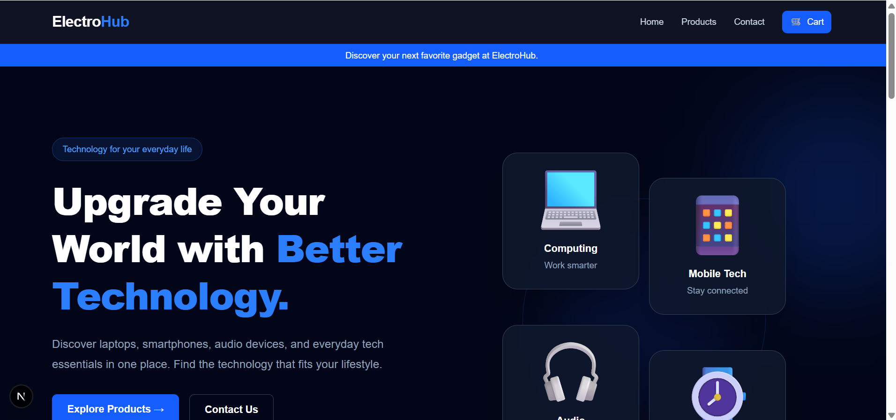
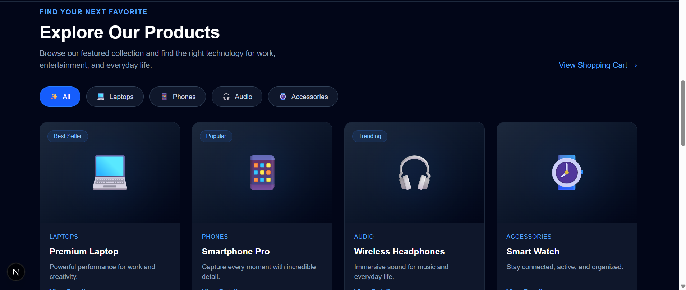
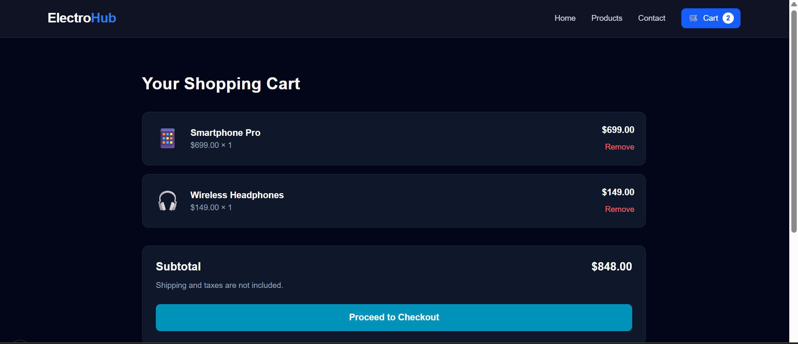
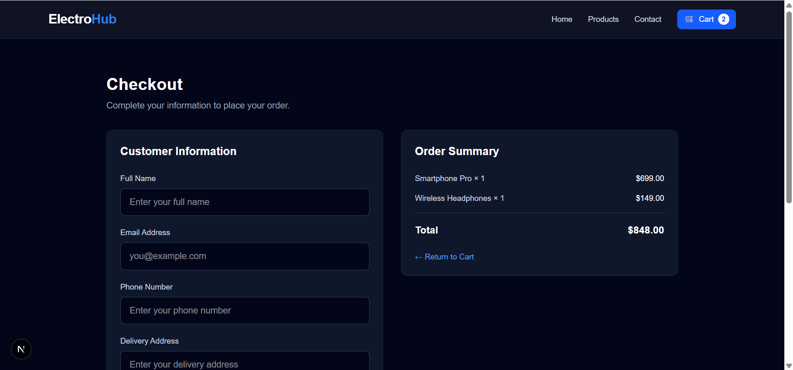
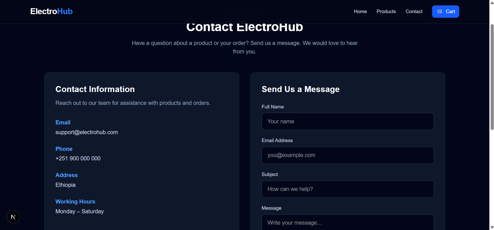
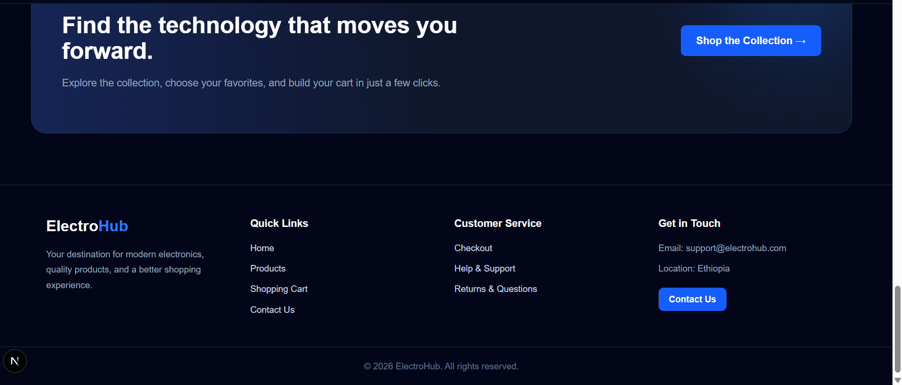

# ElectroHub 🛒

ElectroHub is a modern electronics e-commerce website built with Next.js and TypeScript. It provides a clean shopping experience where users can explore electronic products, view product details, manage their shopping cart, and proceed to checkout.

## ✨ Features

- 🏠 Attractive homepage
- 📱 Product listings and categories
- 🔍 Individual product detail pages
- 🛒 Add products to the shopping cart
- 🧺 View and remove cart items
- 💳 Checkout page
- 📞 Contact page
- 📱 Responsive layout
- ⚡ Fast navigation with Next.js

## 🛠️ Technologies Used

- Next.js
- React
- TypeScript
- Tailwind CSS
- JavaScript
- HTML

## 📸 Screenshots

### Home Page


### Product Page


### Add to Cart


### Checkout Page


### Contact Page


### Footer


## 📂 Project Structure

```text
app/
├── data/
│   └── products.ts
├── products/
│   └── [id]/
│       └── page.tsx
├── cart/
├── checkout/
├── contact/
├── components/
└── page.tsx

public/
└── screenshots/
    ├── home.png
    ├── productpage.png
    ├── addtocart.png
    ├── checkout.png
    ├── contact.png
    └── footer.png

README.md
package.json
```

## 🚀 Getting Started

### Prerequisites

- Node.js
- npm

### 1. Clone the repository

```bash
git clone https://github.com/Salahudin888/electrohub.git
```

### 2. Open the project folder

```bash
cd electrohub
```

### 3. Install dependencies

```bash
npm install
```

### 4. Start the development server

```bash
npm run dev
```

### 5. Open in your browser

Visit [http://localhost:3000](http://localhost:3000).

## 🛍️ Sample Products

ElectroHub includes products such as:

- Premium Laptop
- Smartphone Pro
- Wireless Headphones
- Smart Watch
- Gaming Laptop
- Wireless Earbuds
- Tablet Pro
- Digital Camera

## 🎯 Project Goal

The goal of ElectroHub is to build a user-friendly e-commerce interface while developing practical skills in React, Next.js, TypeScript, reusable components, dynamic routing, and shopping cart functionality.

## 👨‍💻 Author

**Salahudin Murad**

- GitHub: [Salahudin888](https://github.com/Salahudin888)

## 📄 License

This project is available for learning and portfolio purposes.
